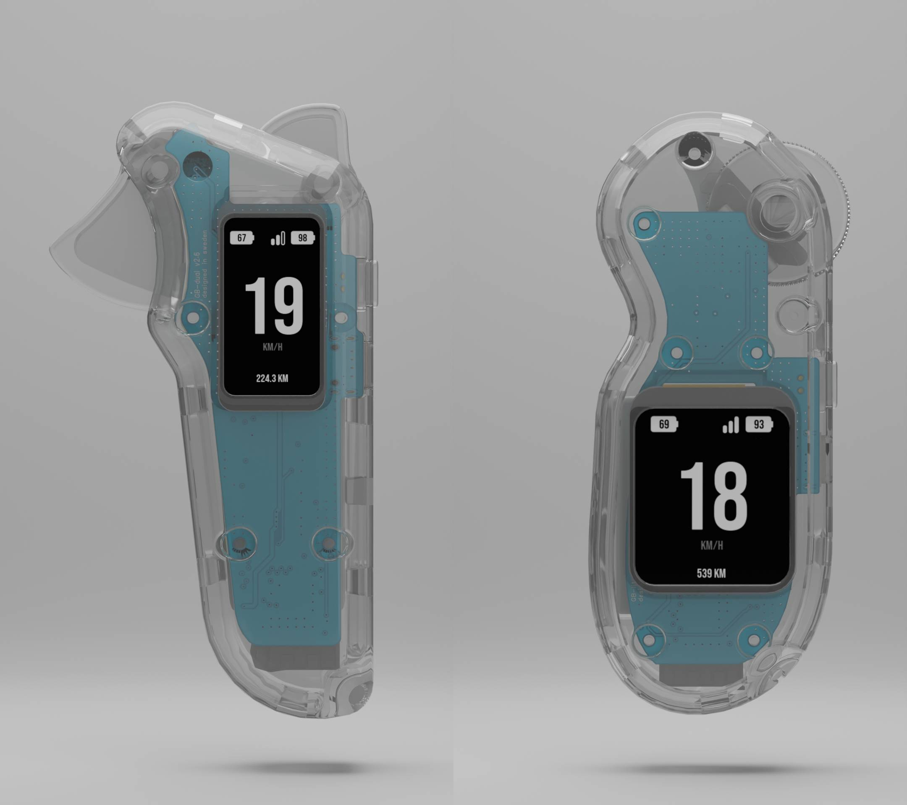

# GB Remote

<div align="center">
  
</div>

A source-available hand controller for electric skateboards built with the ESP32-S3. This project provides a complete wireless control solution with real-time telemetry monitoring, featuring a custom BLE protocol that communicates with VESC motor controllers and JBD (Jiabaida)/Kaly BMS systems.

> **Safety:** this firmware moves a vehicle and is experimental. Test every
> build, and every setting change, with the wheels off the ground. If the
> remote loses its link the receiver brakes; if the remote's own battery runs
> low it stops sending throttle (braking still works) and then powers off.

This repository contains the **remote controller firmware**. The complete system also includes:
- **Receiver Firmware** (`gb_receiver`): The BLE server firmware that runs on the receiver

## Key Features

### Intuitive Control Interface
- **Analog Throttle Control**: High-precision ADC-based throttle input with automatic calibration
- **Dual Throttle Support**: Separate throttle and brake inputs on dual throttle variant with neutral position
- **Smart Button Interface**: Multi-function button with long-press and double-press detection
- **Haptic Feedback**: Vibration patterns for connection status, alerts, and user feedback
- **Sleep Management**: Automatic power management with inactivity detection and power modes
- **Power Management**: Soft latching hardware where power consumption while "sleeping is 1uA"

### Modern UI
- **LVGL Graphics Library**: Beautiful, responsive user interface built with EEZ Studio (open-source)
- **Real-time Speed Display**: Large, easy-to-read speedometer with km/h and mi/h display
- **Dual Battery Monitoring**: Separate battery indicators for controller and skateboard
- **Connection Status**: Visual feedback for BLE connection quality
- **Trip Distance Tracking**: Built-in odometer with persistent storage
- **Adjustable Backlight**: Configurable display brightness (0-100%)

### Comprehensive Telemetry
- **VESC Integration**: Real-time data from VESC
- **BMS Support**: Full battery management system monitoring with cell-level voltage tracking
  - **Compatible BMS Systems**: Jiabaida and Kaly BMS telemetry support
  - **Cell Voltage Monitoring**: Individual cell voltage tracking for up to 16 cells
  - **Capacity Tracking**: Real-time remaining and nominal capacity monitoring
- **Custom BLE Protocol**: Optimized data transmission for low latency and high reliability
- **Automatic Parameter Configuration**: Motor pulley, wheel diameter, and throttle settings are automatically retrieved by the receiver from the vesc


## Hardware Variants

The firmware supports two hardware variants:

### GB Remote Lite
- **Display**: 240×320 pixel TFT LCD
- **Throttle**: Single analog throttle with inversion support
- **Use Case**: Standard single-throttle control

### GB Remote Dual Throttle
- **Display**: 172×320 pixel TFT LCD
- **Throttle**: Dual analog inputs (throttle + brake)
- **Use Case**: Separate throttle and brake control with neutral position

Both variants share the same core firmware with target-specific configurations.

## Technical Specifications

### Hardware Platform
- **MCU**: ESP32 S3
- **Display**: TFT LCD ST7789 (resolution varies by variant)
- **Input**: Analog throttle with ADC calibration (dual inputs on dual throttle variant)
- **Connectivity**: Bluetooth Low Energy (BLE) SPP client
- **Power**: Built-in battery monitoring and power management
- **Haptic Feedback**: Vibration motor for user notifications

### Software Architecture
- **RTOS**: FreeRTOS for real-time task management
- **Graphics**: LVGL 9.1.0 with EEZ Studio UI
- **Communication**: Custom BLE SPP protocol for VESC/BMS data
- **Storage**: NVS flash for configuration and trip data
- **Power Management**: Advanced power modes and soft latching circuit

## Communication Protocol

### BLE SPP Protocol
- **Service UUID**: `0xABF0`
- **Characteristics**: `0xABF1` throttle, `0xABF2` telemetry, `0xABF3` commands, `0xABF4` status
- **Definition**: [`firmware/main/gb_protocol.h`](firmware/main/gb_protocol.h), shared with `gb_receiver` (which owns it)
- **Data Exchange**: Throttle/brake commands from remote, VESC and BMS telemetry from receiver

### Pairing
The remote and receiver bond over BLE with a static passkey
(`CONFIG_GB_BLE_PASSKEY`, the same value on both; set your own for builds you
ship). After that each only talks to the other:

1. On the receiver's Wi-Fi setup page, scan and add the remote (it advertises
   as `GS-REM`). The receiver now accepts only the remotes on that list.
2. A remote with no bonded receiver pairs with the first receiver that lets it
   connect. A remote that already has one only accepts a new receiver during a
   60 s pairing window: enable dual connection, or send `START_PAIRING` from
   the configuration tool.
3. To replace a receiver, send `FORGET_RECEIVERS` from the configuration tool;
   the remote then pairs again as in step 2.

### USB Serial Binary Protocol
The remote communicates with the configuration tool via a binary protocol over USB Serial (USB CDC):

- **Packet-based**: Binary protocol with CRC-16-CCITT error checking
- **Real-time Streaming**: Configurable data streaming (1-100 Hz) for monitoring and debugging
- **Commands**: Firmware version, configuration management, calibration, odometer control, BLE trim adjustment
- **Documentation**: See [`firmware/docs/USB_SERIAL_PROTOCOL.md`](firmware/docs/USB_SERIAL_PROTOCOL.md) for complete protocol specification


## Project Structure

This repository contains the **remote controller firmware**. The complete GB Remote system consists of:

1. **Remote Controller** (this repository): ESP32S3-based hand controller with display and throttle
2. **Receiver Firmware** (`gb_receiver`): BLE server firmware for the skateboard/receiver side that interfaces with VESC and BMS

## Getting Started

### Prerequisites
- ESP-IDF 5.5.x, exported in your shell (`. $IDF_PATH/export.sh`)

### Build & Flash

```bash
cd firmware
./build.sh lite                   # 240×320, single throttle
./build.sh dual_throttle --flash  # 172×320, throttle + brake; --port PORT to choose
idf.py -B build_lite monitor      # each variant has its own build dir
```

Releases are built by CI: bump `firmware/main/version.h`, merge, then run
`firmware/release.sh`, which pushes the `v*` tag.

Or use the [Configuration Tool](https://gbengineering.se/config-tool/) for easy firmware updates.

## Configuration Tool

**Easy Configuration via Web Interface**

Configure your GB Remote controller easily using our online configuration tool hosted on the GB Engineering website:

**[GB Remote Configuration Tool](https://gbengineering.se/config-tool/)**

The configuration tool provides a comprehensive web-based interface for setting up and managing your GB Remote system.

### Features:
- **USB Serial Connection**: Connect directly via USB cable
- **Real-time Configuration**: Adjust settings without recompiling firmware
- **Automatic Firmware Updates**: The configuration tool automatically checks for firmware updates every time the remote is connected. Update with a simple button confirmation
- **Throttle Calibration**: Calibrate throttle and brake inputs with guided calibration process
- **Speed Unit Toggle**: Switch between km/h and mph display units
- **Backlight Control**: Adjustable display brightness (0-100%)
- **BLE Trim Adjustment**: Fine-tune BLE output offset for precise throttle control
- **Odometer Management**: Reset trip distance counter
- **Real-time Data Streaming**: Monitor live telemetry data at configurable rates (1-100 Hz)
- **Status Monitoring**: Real-time device status and logs

### Quick Setup:
1. Flash the firmware to your Remote (and Receiver if needed)
2. Connect your controller via USB cable
3. Open the [Configuration Tool](https://gbengineering.se/config-tool/)
4. Click "Connect to Remote" to establish USB serial connection
5. Configure your settings and calibrate throttle


## BMS Compatibility

This controller is specifically designed to work with popular electric skateboard BMS systems:

- **JBD (Jiabaida) BMS**: Full telemetry support including cell voltages and capacity data
- **Kaly BMS**: Complete compatibility with all monitoring features

The receiver firmware (`gb_receiver`) handles the BMS communication and forwards the telemetry data to the remote controller via BLE.


## Contributing

Contributions are welcome; see [CONTRIBUTING.md](CONTRIBUTING.md). Report
security issues privately as described in [SECURITY.md](SECURITY.md).

### Hardware
The remote is built around an ESP32-S3 with 4 MB flash and quad PSRAM, an
ST7789 SPI display, hall-effect throttle (and brake) sensors on ADC1, a
single-cell Li-ion with a soft-latching power circuit, and a vibration motor.
Pin assignments are in [`firmware/main/hw_config.h`](firmware/main/hw_config.h).

### Pre-commit hooks

To enable auto-formatting (trailing whitespace trim + clang-format on C/C++ files) before each commit:

```bash
git config core.hooksPath githooks
```

Requires [clang-format](https://clang.llvm.org/docs/ClangFormat.html) (e.g. `brew install clang-format` on macOS).

## License

[PolyForm Noncommercial 1.0.0](LICENSE): free for personal, educational,
research and other noncommercial use, including modifying and sharing it. This
makes the project source-available, not open source. For commercial use,
contact the author. Third-party components keep their own licenses, see
[THIRD_PARTY_NOTICES.md](THIRD_PARTY_NOTICES.md).
